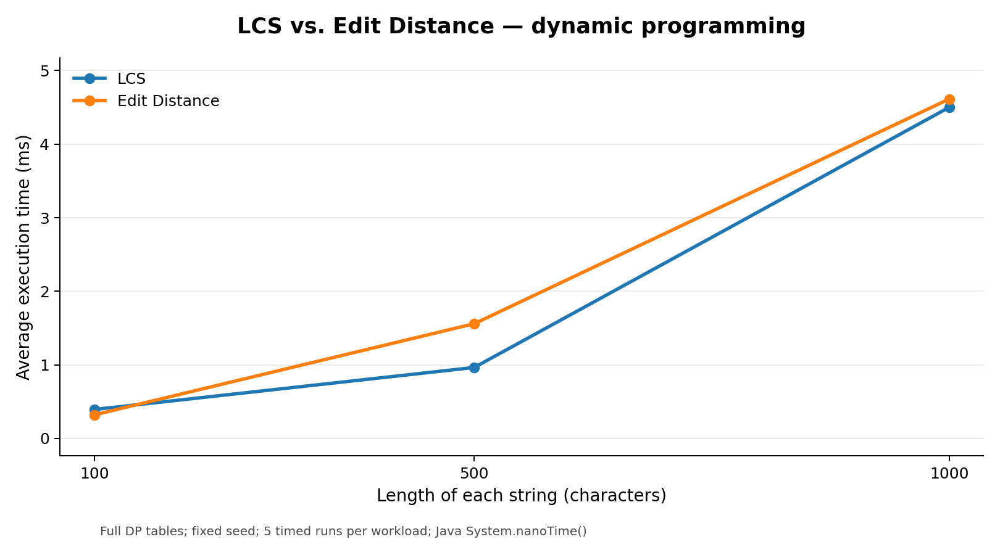
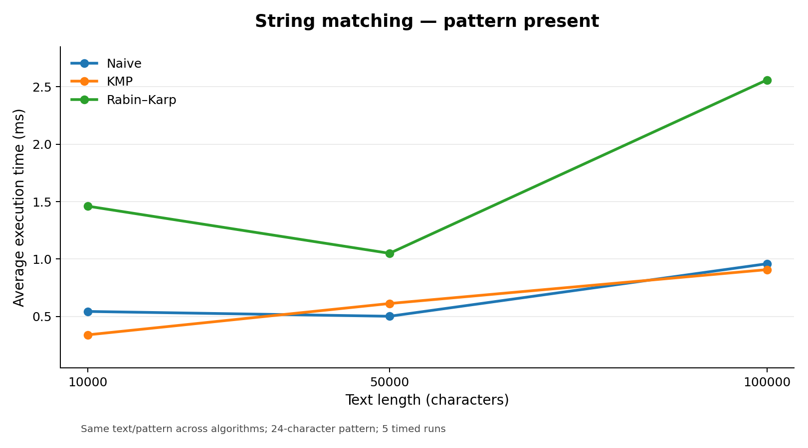
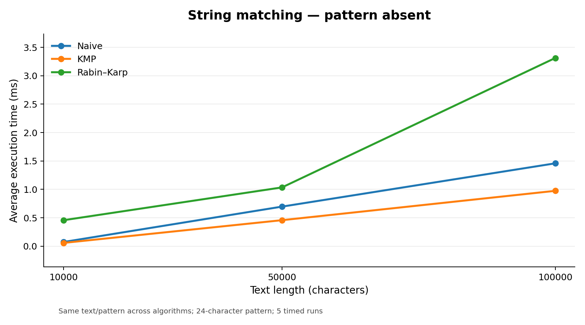
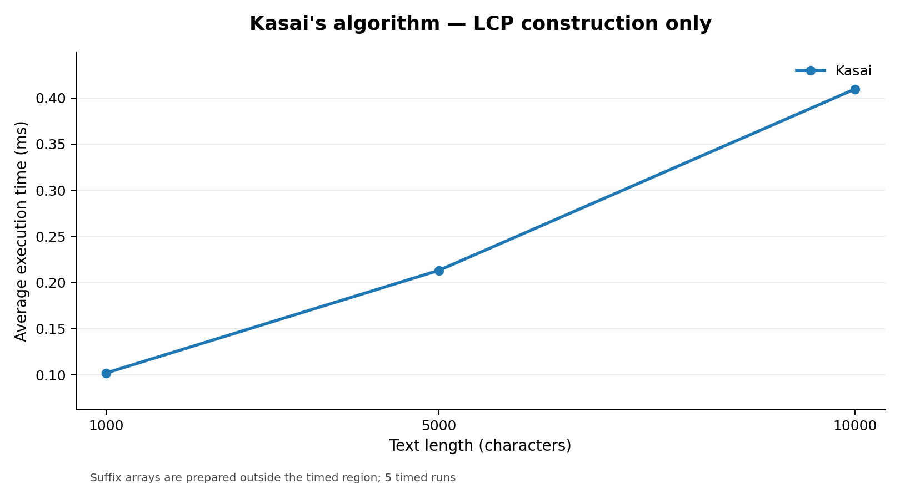

# Assignment 4 — Text Analysis in Java

This project implements six algorithms in Java, tests their correctness, and compares their performance using different input sizes.

## 1. Algorithms

- **Longest Common Subsequence (LCS):** Finds the length of the longest subsequence shared by two strings. Its DP table uses `dp[i][j] = dp[i-1][j-1] + 1` when characters match; otherwise it takes `max(dp[i-1][j], dp[i][j-1])`. An empty prefix gives 0. These choices work because a common subsequence either includes the matching characters or must skip one of the different characters.
- **Edit Distance:** Finds the minimum insertions, deletions, and substitutions needed to change one string into another. Its DP table starts with `dp[i][0] = i` and `dp[0][j] = j`, then takes the minimum cost of deleting, inserting, or matching/substituting a character. Every possible last edit is covered by one of these choices.
- **Naive matching:** Checks the pattern at each possible starting position.
- **KMP:** Builds an LPS (longest proper prefix that is also a suffix) table. On a mismatch, it uses LPS to avoid comparing characters again.
- **Rabin–Karp:** Uses rolling hashes. When two hashes match, it compares the characters to prevent false matches from hash collisions.
- **Kasai:** Uses an existing suffix array to build an LCP array. Each LCP value gives the common prefix length of two neighboring suffixes in sorted order. The algorithm reuses previous matching lengths to avoid unnecessary comparisons.

## 2. Implementation choices

The algorithms were written in Java without using library implementations of the algorithms. For string matching, results are **zero-based indices**, including overlapping matches. An empty pattern matches at every position from `0` through the text length; a longer-than-text pattern has no matches. Inputs must be non-null, and indices follow Java `char` positions. Edit operations all cost 1. Rabin–Karp uses base 256 and modulus 1,000,000,007. Kasai receives a valid suffix array; the simple suffix-array builder is only used for test and benchmark inputs.

For the short example `banana`, the suffix array is `[5, 3, 1, 0, 4, 2]`, and Kasai produces `[0, 1, 3, 0, 0, 2]`.

## 3. Complexity analysis

Let `a` and `b` be the lengths of the two DP strings, `n` the text/string length, and `m` the pattern length. Space excludes the returned match list.

| Algorithm | Main operation | Best time | Worst time | Extra space |
|---|---|---|---|---|
| LCS | Fill DP table using match or maximum | O(ab) | O(ab) | O(ab) |
| Edit Distance | Fill DP table using minimum edit cost | O(ab) | O(ab) | O(ab) |
| Naive | Compare pattern at each position | O(n) | O(nm) | O(1) |
| KMP | Build LPS, then scan text | O(n + m) | O(n + m) | O(m) |
| Rabin–Karp | Compute rolling hashes; verify hash matches | O(n + m) expected | O(nm) | O(1) |
| Kasai | Compare adjacent suffixes while reusing LCP | O(n) | O(n) | O(n) |

Both DP algorithms fill `a × b` cells. Naive matching may check `m` characters at each position. KMP avoids restarting comparisons, so preprocessing takes O(m) and searching takes O(n). Rabin–Karp also preprocesses in O(m), but repeated hash collisions or genuine matches can lead to O(nm) verification work. Naive preprocessing is O(1). Kasai is O(n) **after the suffix array has been provided**; suffix-array construction is not included in this bound. For short inputs, early returns can be faster than these general bounds.

## 4. Correctness tests

Tests cover:

- **LCS:** identical strings, unrelated strings, empty strings.
- **Edit Distance:** identical and empty strings; insertion, deletion, substitution.
- **Matching:** beginning, middle, end, multiple and overlapping matches, absent pattern, longer pattern, empty pattern.
- **Kasai:** manually checked `banana` suffix array and LCP array.

The matching tests check that Naive, KMP, and Rabin–Karp return identical indices. Random tests and a hash-collision test are also included. **766 assertions passed.** See [`results/test_output.txt`](results/test_output.txt).

## 5. Experimental setup

| Algorithm group | Input sizes |
|---|---|
| LCS, Edit Distance | Two strings of length 100, 500, 1,000 |
| String matching | Text length 10,000, 50,000, 100,000 |
| Kasai | String length 1,000, 5,000, 10,000 |

Random strings use alphabet `abcd` with seed `20261029`. Matching patterns have length 24; each size is tested with the pattern **present** and **absent**. All three matchers use the same input in each comparison, and both DP algorithms use the same string pairs.

Each case runs 30 warmup iterations followed by **five timed runs** using `System.nanoTime()`. Tables show the average in milliseconds. Input generation, output, file writing, validation, and suffix-array construction are excluded from timing. Matching operation counters are included in the algorithm timing. Measurements were made with OpenJDK 21.0.12.1 on Linux x86-64 (Intel Xeon Platinum 8573C). Results may vary on other machines.

## 6. Experimental results

### Dynamic programming — average time (ms)

| String length | LCS | Edit Distance |
|---:|---:|---:|
| 100 | 0.3936 | 0.3205 |
| 500 | 0.9645 | 1.5594 |
| 1,000 | 4.5001 | 4.6131 |



### String matching — average time (ms)

| Text length | Naive present | KMP present | Rabin–Karp present | Naive absent | KMP absent | Rabin–Karp absent |
|---:|---:|---:|---:|---:|---:|---:|
| 10,000 | 0.5434 | 0.3394 | 1.4607 | 0.0727 | 0.0567 | 0.4565 |
| 50,000 | 0.5013 | 0.6124 | 1.0498 | 0.6961 | 0.4573 | 1.0343 |
| 100,000 | 0.9588 | 0.9077 | 2.5599 | 1.4581 | 0.9739 | 3.3128 |





### Kasai — average time (ms)

| String length | Kasai |
|---:|---:|
| 1,000 | 0.1021 |
| 5,000 | 0.2132 |
| 10,000 | 0.4096 |



### Operation counts (text length 100,000)

| Pattern | Algorithm | Preprocessing character comparisons | Search character comparisons | Hash collisions |
|---|---|---:|---:|---:|
| Present | Naive | 0 | 133,259 | 0 |
| Present | KMP | 26 | 124,963 | 0 |
| Present | Rabin–Karp | 0 | 24 | 0 |
| Absent | Naive | 0 | 133,335 | 0 |
| Absent | KMP | 28 | 124,962 | 0 |
| Absent | Rabin–Karp | 0 | 0 | 0 |

Rabin–Karp's character comparison count does not include rolling-hash calculations. Full measurements and additional counts are in [`results/benchmarks.csv`](results/benchmarks.csv).

## 7. Discussion

LCS and Edit Distance become slower as their DP tables grow. Naive matching performed reasonably well on these random inputs because mismatches often happened early. KMP avoided repeated comparisons and has a better guaranteed worst-case time. Rabin–Karp had few direct character checks but sometimes took longer because of hash calculations. Kasai's timings grew roughly in proportion to string length, matching its O(n) complexity.

Big-O describes growth as input size increases; measured times also depend on Java and the computer, so they do not increase perfectly smoothly.

## 8. Conclusion

The DP algorithms are easy to understand but need O(ab) memory. Naive matching is simple, KMP offers reliable linear-time matching, and Rabin–Karp trades character comparisons for hash calculations and collision checks. Kasai efficiently builds LCP when a suffix array is already available. The fastest algorithm in practice depends on the input, not just its theoretical complexity.

## How to compile and run

Requires **JDK 17 or newer**. Open the project in IntelliJ IDEA and run `AlgorithmTests` or `BenchmarkRunner`, or use the following commands from the project directory.

**Windows PowerShell:**

```powershell
New-Item -ItemType Directory -Force build/classes | Out-Null
$files = Get-ChildItem src/main/java,src/test/java -Recurse -Filter *.java | ForEach-Object FullName
javac --release 17 -d build/classes $files
java -cp build/classes edu.textanalysis.AlgorithmTests
java -cp build/classes edu.textanalysis.benchmark.BenchmarkRunner
```
